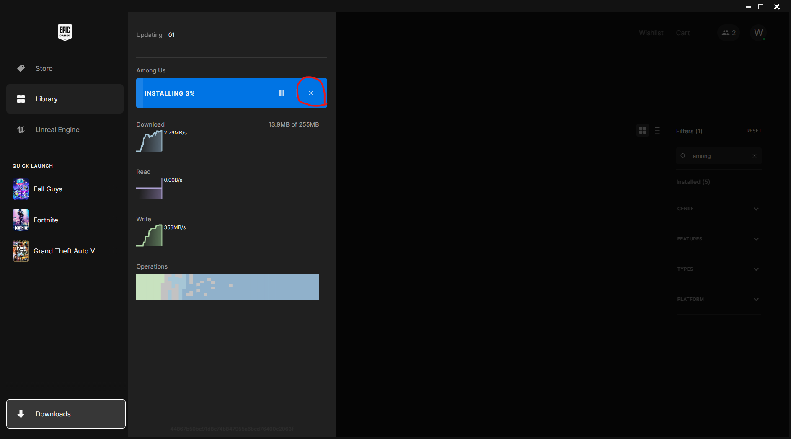
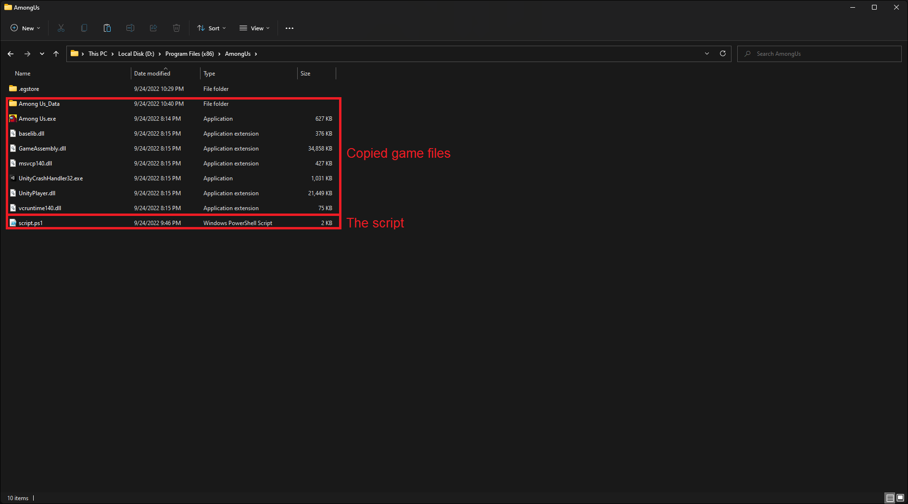
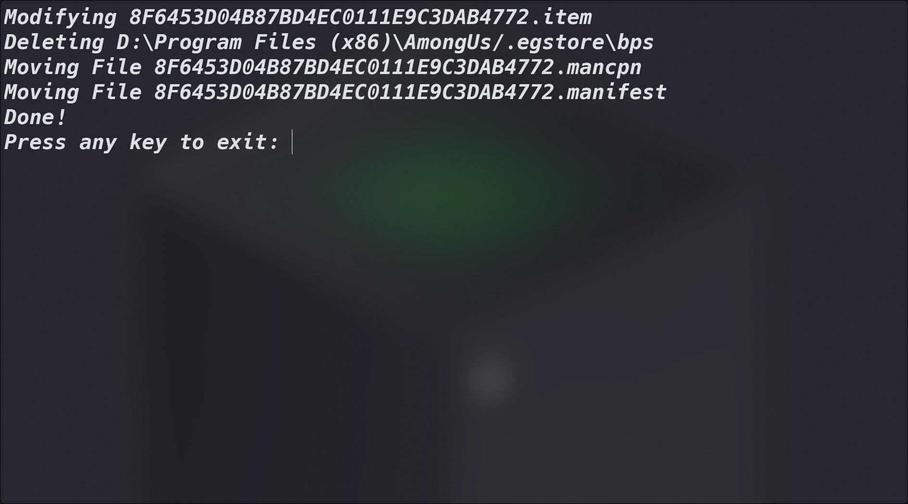

# A script to transfer Epic launcher games between machines
This script helps with transferring already downloaded games from other machines without downloading extra files or waiting for the verification process which is sometimes prone to errors.

> **Warning**
> USE IT AT YOUR OWN RISK! I am not responsible for the misuse of this script, backup your game data and follow the steps carefully.

> **Note**
> This script is only tested on transferring games download **FROM** Epic launcher **TO** Epic launcher

# GUI version
`gui/` contains a desktop app built with [GPUI](https://www.gpui.rs/) that walks you through the whole transfer and does most of it for you. Instead of following the steps below by hand, run it and do what it says:

1. **Start the download in Epic.** It opens the launcher, tells you what to click, and notices the download by itself.
2. **Close Epic.** It detects that the launcher is still running and can close it for you.
3. **Choose your game files.** Point it at the copy you brought (other PC, USB drive, backup). It checks the copy against Epic's manifest: whether the game's .exe is there, the expected size, and free disk space. If you pick the folder *containing* the game, it uses the game folder inside it. It also won't let you finish when only Epic's partial download is in the install folder.
4. **Copy the files.** It copies the game into the install folder with a progress bar, skipping the other PC's `.egstore`.
5. **Finish.** It does what `script.ps1` does, then offers to reopen Epic.

Build it (needs Rust and the MSVC Build Tools with the Windows SDK):
```powershell
cd gui
cargo build --release
.\target\release\epic-copy.exe
```
Set `EPIC_MANIFESTS_DIR` to point the app at a different manifests folder (useful for testing with fake data).

# Prerequisites
- Game files that are downloaded from Epic launcher and are up-to-date from your machine or your friend's machine.
- Only `script.ps1` from this repository

## Step 1
Open Epic launcher and download the game that you are going to transfer, wait until it downloads approximately 10MB then press X to cancel the install. 


## Step 2
Exit Epic launcher and make sure it is not running in the task manager.

## Step 3
Copy all files inside the game folder that you have already downloaded or copied from a friend to the install location that you have chosen previously, copy everything except `.egstore` folder.

## Step 4
Copy `script.ps1` inside the root of the install location. After copying the game files and the script it should be something like this


## Step 5
Right-click on the script and press **Run with PowerShell**, after it finishes press any key to close the window.


## Step 6
Open Epic launcher and you should see "Launch" instead of resume beneath the game.
