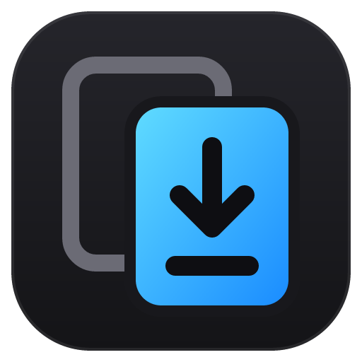
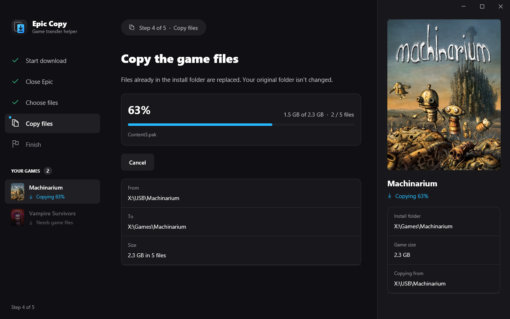
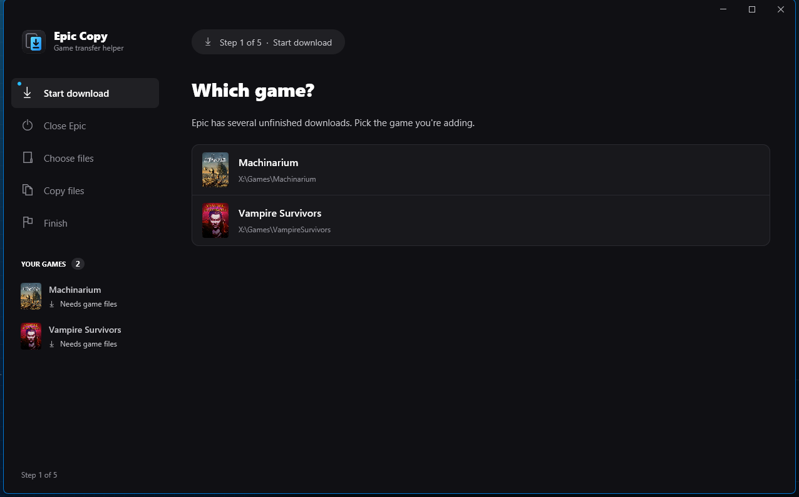
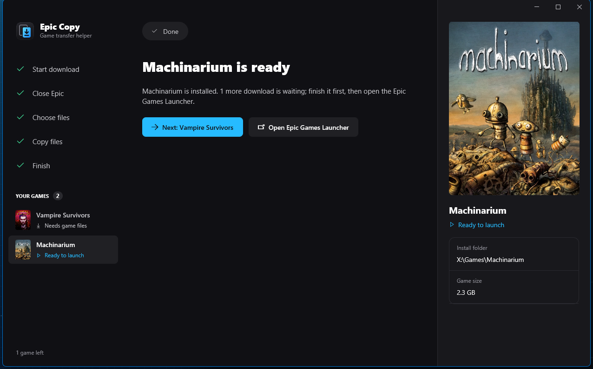

<p align="center">
  
</p>

<h1 align="center">Epic Copy</h1>

<p align="center">
  Add games you already have to the Epic Games Launcher, without downloading them again.
</p>

<p align="center">
  
  
  
</p>

<p align="center">
  
</p>

Got a game's files from another PC, a USB drive or a backup? Epic Copy places them where the launcher expects them, then marks the install as complete, so the launcher shows **Launch** instead of downloading everything again.

## Features

- **Guided steps.** It notices when you start the download in Epic, offers to close the launcher, and moves on by itself.
- **Checks your copy.** It looks for the game's executable and compares the size with Epic's manifest. It also checks free disk space, and won't finish with only a partial download in place.
- **Copies for you.** Progress is shown live, and the other PC's `.egstore` data is skipped.
- **Several games at once.** Every unfinished download is listed, each with its own progress, and you can switch between them freely.
- **Real cover art.** Covers come from the launcher's local catalog and are cached for offline use.

<p align="center">
  
  
</p>

## Download

Grab the latest `EpicCopy-…-windows-x64.zip` from [Releases](../../releases/latest), unzip it and run `epic-copy.exe`. A new build is published automatically every time a change is merged into `master`.

## Build

Requires [Rust](https://rustup.rs) and the Visual Studio Build Tools (C++ workload and Windows SDK).

```powershell
cargo run --release
```

## How it works

1. Starting a download makes Epic create a pending manifest and a partial-download state (`.egstore\bps`).
2. Epic Copy copies your game files into the install folder.
3. It marks the pending manifest as complete, removes `bps`, and promotes the downloaded install manifest.

Every check runs before anything on disk is touched. If a step fails partway through, the manifest change is rolled back.

> [!WARNING]
> Use at your own risk and back up your game files first. Epic Copy is an independent tool and is not affiliated with or endorsed by Epic Games.
